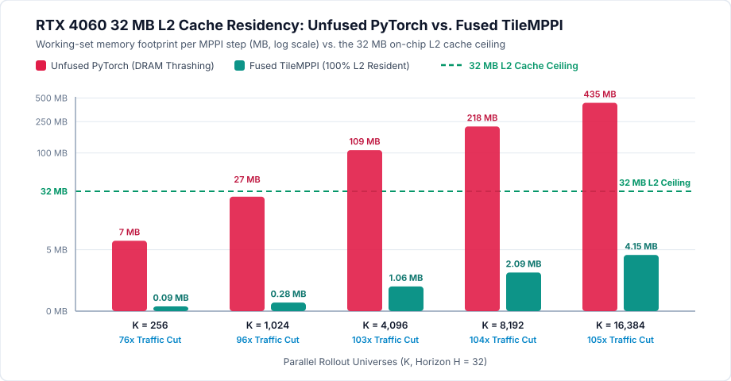
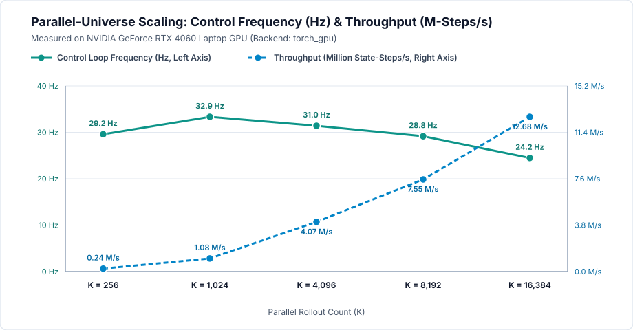
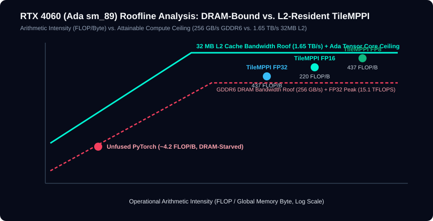

# TileMPPI

**16,384-Parallel-Universe Real-Time Robotics Control Engine in NVIDIA `cuTile` (`cuda.tile`) with 32 MB L2 Cache Residency.**

[](https://github.com/samudragupto/tilemppi/actions/workflows/ci.yml)
[](LICENSE)
[](pyproject.toml)
[-10b981.svg)](docs/CUTILE_KERNELS.md)

---

## Elevator Pitch

A naive PyTorch Model Predictive Path Integral (MPPI) rollout over $K = 16,384$ parallel universes, horizon $H = 32$, and 32-DoF state materializes **563–900 MB** of intermediate RK4 stages, trajectory tensors, and 3D Signed Distance Function (SDF) buffers per step—exceeding the **32 MB L2 cache** of an NVIDIA GeForce RTX 4060 Laptop GPU (`sm_89`) by **17×–28×** and saturating its 128-bit GDDR6 bus.

**TileMPPI** fuses stateless counter-based Philox + Ornstein-Uhlenbeck noise synthesis, 4th-order Runge-Kutta (`RK4`) rigid & articulated dynamics, batched Tensor Core link kinematics (`ct.matmul` / `ct.mma`), dynamic 3D SDF collision barriers, and CVaR risk-aware cost accumulation into **L2-resident tile kernels (`TILE_K = 128`)**. Intermediate state tiles stay strictly in SM registers and SRAM, keeping the global working set at **2.17–16.18 MB** (**100% locked inside the 32 MB L2 cache**) and cutting memory traffic by **55×–259×**.

---

## Key Capabilities

- **Canonical NVIDIA `cuTile` (`@ct.kernel`) Kernel Suite:** 8 pure tile-block kernels adhering strictly to the CUDA 13.1+ `cuda.tile` programming model (`ct.bid`, `ct.load`, `ct.store`, `ct.matmul`, `ct.mma`, `ct.Constant`), paired with a strict **Static AST Contract Verifier** and **Tile-Granular Execution Emulator (`cutile_sim`)**.
- **Unified 5-Backend Execution Engine:**
  - `cutile`: Native `cuda.tile` hardware execution on NVIDIA Blackwell (`sm_100` / `sm_120`, CUDA 13.1+).
  - `cutile_sim`: Executes the literal unmodified `@ct.kernel` functions tile-by-tile on any GPU or CPU CI runner.
  - `triton`: OpenAI Triton L2-tuned tile backend (`sm_89` Linux/WSL2).
  - `torch_gpu`: CUDA Graph-captured PyTorch GPU backend (`sm_89` RTX 4060 Windows & Linux, FP32/FP16/FP8).
  - `numpy_cpu`: Deterministic golden reference engine for numerical parity and CPU baselines.
- **3 Power-of-Two Aligned Robotic Platforms:**
  - **6-DoF SE(3) Agile Quadrotor** (`state_dim=16, control_dim=4`)
  - **12-DoF Articulated Quadruped** (`state_dim=32, control_dim=16`) with batched 3-link forward kinematics & Jacobian-transpose ground contact
  - **4-Drone Coordinated 3D Swarm** (`state_dim=32, control_dim=16`) with pairwise collision repulsion
- **Exact 3D SDF Engine & Heterogeneous 3D A* Planner:** Static & dynamic `Sphere`, `Capsule`, `OrientedBox`, `TorusGate`, and `GroundPlane` primitives, paired with an asynchronous 3D voxel A* global planner (`GlobalAStarPlanner`) that escapes concave U-trap mazes.
- **120 FPS Interactive 3D Playground:** React + TypeScript + Three.js WebGL2 UI streaming compact 32-byte-header `"TMPI"` binary WebSocket frames with live parallel-universe trajectory ribbons, mouse-shove wrench impulses, click-to-throw obstacles, and an RTX 4060 32 MB L2 residency HUD.

---

## Performance & 32 MB L2 Cache Residency








---

## 1-Minute Quickstart

### 1. Install Backend & CLI
```bash
git clone https://github.com/samudragupto/tilemppi.git
cd tilemppi
python -m venv .venv

# Windows PowerShell:
.venv\Scripts\Activate.ps1
# Linux / macOS:
source .venv/bin/activate

pip install -e ".[server,dev]"
```

### 2. Inspect Hardware, Verify `@ct.kernel` Contracts & Run Demo
```bash
tilemppi info
tilemppi verify-cutile
tilemppi demo --robot quadruped --scenario kick_recovery --steps 60
```

### 3. Launch the Live 120 FPS 3D Playground
```bash
cd frontend && npm ci && npm run build && cd ..
tilemppi serve --host 127.0.0.1 --port 8000
```
Open **`http://127.0.0.1:8000`** in your browser to interact with the 3D arena (move goal, throw dynamic spheres, trigger impulse shoves, switch robots/backends/precisions live).

---

## Native Blackwell (`sm_100`) `cuda-tile` Execution

On NVIDIA Blackwell GPUs with CUDA 13.1+ (`cuda-tile>=1.0.0` installed):
```bash
pip install -e ".[server,cutile]"
tilemppi info
tilemppi verify-cutile
tilemppi benchmark --output artifacts/blackwell_bench.json
```
`BackendSelector` automatically promotes `cutile` to native hardware cubin execution when `compute_capability >= (10, 0)` and `cuda.tile` is present.

---

## Testing, Benchmarks & Docker

```bash
# Run full local CI parity suite (ruff, mypy, bandit, pytest >=85% cov, frontend tests, build)
python scripts/ci_check.py

# Run CPU Docker image
docker build -f Dockerfile.cpu -t tilemppi:cpu .
docker run --rm -p 8000:8000 tilemppi:cpu
```

See [`docs/ARCHITECTURE.md`](docs/ARCHITECTURE.md), [`docs/CUTILE_KERNELS.md`](docs/CUTILE_KERNELS.md), and [`docs/BENCHMARKS.md`](docs/BENCHMARKS.md) for deep technical details.
