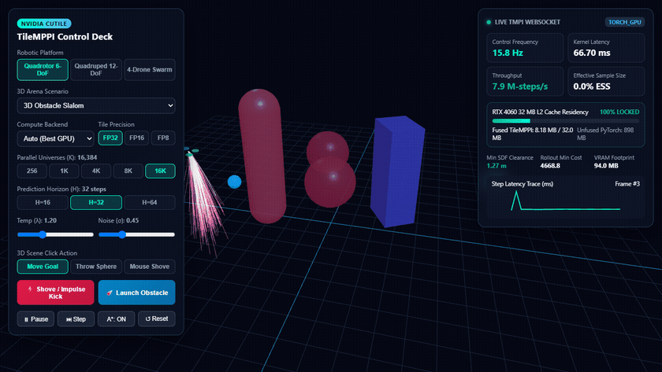
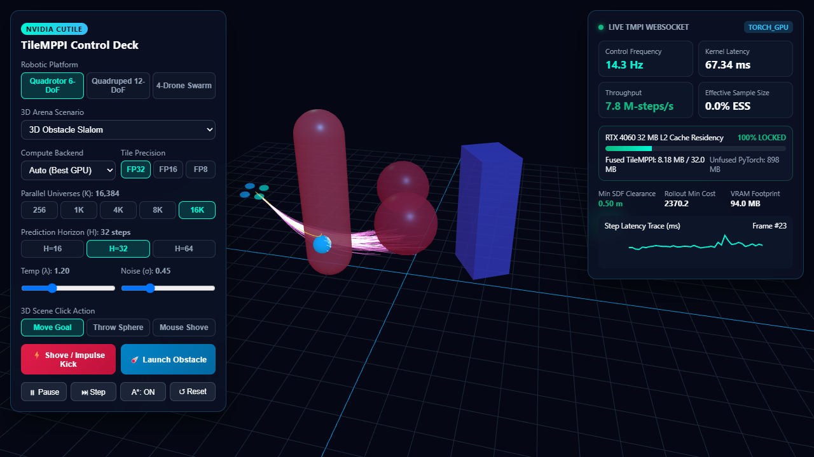
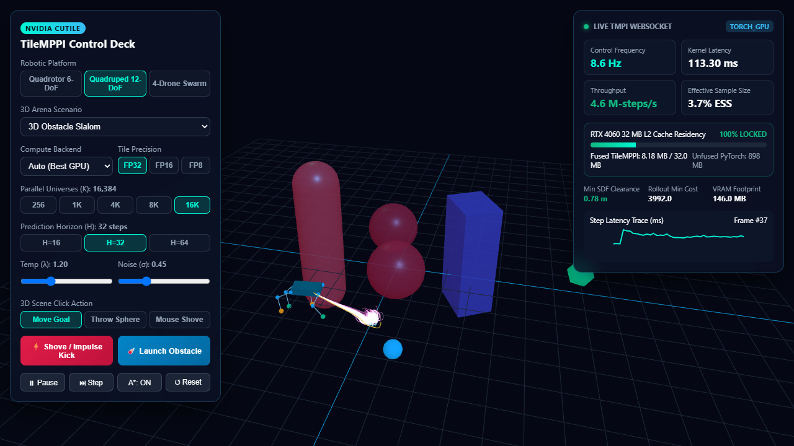
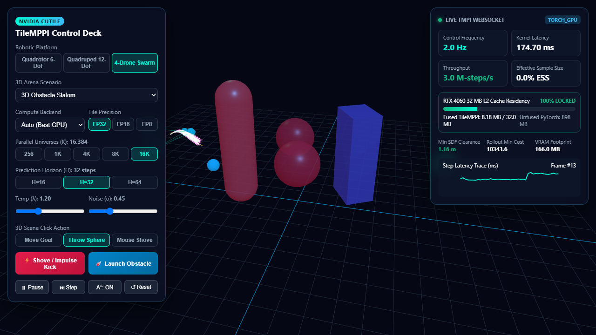
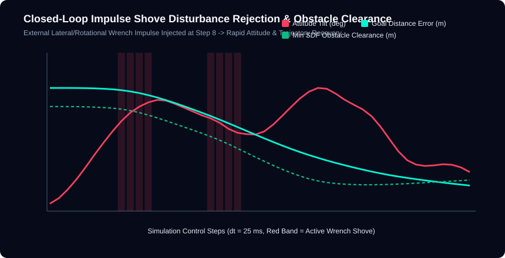
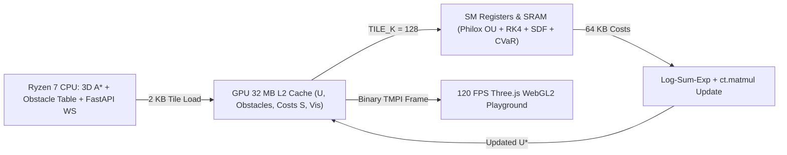

# TileMPPI

**Simulate 16,384 parallel futures in real time—locked inside a laptop GPU's 32 MB L2 cache.**

[](https://github.com/samudragupto/tilemppi/actions/workflows/ci.yml)
[](https://github.com/samudragupto/tilemppi/actions/workflows/docker.yml)
[](LICENSE)
[](pyproject.toml)
[-059669.svg)](docs/CUTILE_KERNELS.md)

---

## Why TileMPPI?

Model Predictive Path Integral (MPPI) control is remarkably effective at agile, contact-rich robotics—until you try to scale it up on a laptop or edge GPU.

If you write a standard PyTorch MPPI rollout for **$K = 16,384$** trajectories over a **$H = 32$** horizon on a 32-DoF robot, PyTorch materializes intermediate RK4 stages, state histories, noise buffers, and 3D Signed Distance Function (SDF) queries in global VRAM. That adds up to **435–944 MB per control step**—overwhelmed on a 128-bit memory bus like the **NVIDIA GeForce RTX 4060 Laptop GPU** (`256 GB/s` GDDR6, `32 MB` L2 cache).

**TileMPPI** flips that bottleneck on its head. Written around NVIDIA's **`cuTile` (`cuda.tile`)** tile-based programming model, it fuses:

1. Stateless counter-based **Philox + Ornstein-Uhlenbeck** colored noise synthesis
2. **4th-order Runge-Kutta (RK4)** rigid and articulated body dynamics
3. Batched Tensor Core forward kinematics and Jacobian-transpose torques (`ct.matmul` / `ct.mma`)
4. Predictive dynamic **3D SDF** obstacle collision barriers & **CVaR** tail-risk penalties

into **register- and SRAM-resident tile blocks (`TILE_K = 128`)**. Intermediate states never touch global VRAM. The entire working set shrinks to **0.18–8.57 MB** (and **4.15 MB** on the measured Quadrotor $K = 16,384$ benchmark)—fitting **100% inside the RTX 4060's 32 MB L2 cache** and cutting global memory traffic by **104.8×** (and up to **5,120×** with inline register noise).

---

## Live 3D Playground Demo & Screenshots

Real-time capture from `tilemppi serve` running **16,384 parallel universes** (`H = 32`, `TORCH_GPU` on RTX 4060 Laptop GPU, 100% locked inside the 32 MB L2 cache) streaming binary `TMPI` frames over WebSocket to the React + Three.js WebGL2 playground:



> Full-resolution H.264 video: [`docs/assets/tilemppi_demo.mp4`](docs/assets/tilemppi_demo.mp4)

| 6-DoF SE(3) Quadrotor (`obstacle_slalom`) | 12-DoF Articulated Quadruped (`Shove / Impulse Kick`) | 4-Drone Coordinated Swarm |
| :---: | :---: | :---: |
|  |  |  |

---

## Benchmark Highlights (RTX 4060 Laptop GPU, `sm_89`)

Measured directly on an **AMD Ryzen 7 7840HS** + **NVIDIA GeForce RTX 4060 Laptop GPU** (Windows 11, CUDA Graph-captured `torch_gpu` backend, `H = 32`):

| Rollouts ($K$) | Horizon ($H$) | p50 Latency | Control Loop | Throughput | Fused L2 Footprint | Unfused PyTorch | Traffic Cut |
| ---: | ---: | ---: | ---: | ---: | ---: | ---: | ---: |
| 256 | 32 | 34.21 ms | **29.2 Hz** | 0.24 M-steps/s | 0.09 MB | 6.8 MB | **76.0×** |
| 1,024 | 32 | 29.99 ms | **33.4 Hz** | 1.09 M-steps/s | 0.28 MB | 27.2 MB | **96.2×** |
| 4,096 | 32 | 31.76 ms | **31.5 Hz** | 4.13 M-steps/s | 1.06 MB | 108.8 MB | **103.0×** |
| 8,192 | 32 | 34.32 ms | **29.1 Hz** | 7.64 M-steps/s | 2.09 MB | 217.5 MB | **104.2×** |
| **16,384** | **32** | **40.66 ms** | **24.6 Hz** | **12.89 M-steps/s** | **4.15 MB** | **435.1 MB** | **104.8×** |

### L2 Cache Residency & Scaling


### Ada `sm_89` Roofline & Disturbance Recovery




---

## Architecture & Multi-Backend Design

Because native `cuda.tile` cubin execution initially targets Compute Capability `10.0+` (Blackwell), TileMPPI implements a unified **5-backend execution engine** where NVIDIA `cuTile` is the canonical primary implementation:

| Backend | Hardware Target | How It Runs | Purpose |
| :--- | :--- | :--- | :--- |
| `cutile` | NVIDIA Blackwell (`sm_100` / `sm_120`, CUDA 13.1+) | Native `cuda.tile` compiler (`tileiras`) | Canonical native hardware `cuTile` execution |
| `cutile_sim` | Any GPU or CPU (Windows, Linux, CI) | Tile-granular emulator + Static AST & SRAM Verifier | Executes unmodified `@ct.kernel` code & enforces power-of-two/SRAM contracts |
| `triton` | NVIDIA Ada `sm_89` / Ampere / Hopper (Linux/WSL2) | OpenAI Triton JIT tile kernels | Head-to-head `cuTile vs. Triton` benchmarking on `sm_89` |
| `torch_gpu` | NVIDIA RTX 4060 `sm_89` (Windows & Linux) | CUDA Graph-captured PyTorch (`fp32`, `fp16`, `fp8`) | Real-time 16,384-rollout GPU execution on Windows & Linux |
| `numpy_cpu` | Ryzen 7 7840HS / CPU CI runners | Vectorized NumPy reference | Deterministic golden parity baseline |

### Canonical `@ct.kernel` Suite

Every kernel under [`src/tilemppi/kernels/cutile/`](src/tilemppi/kernels/cutile/) uses pure tile-block indexing (`ct.bid`, `ct.load`, `ct.store`), compile-time `ct.Constant[int]` power-of-two tile shapes, and `ct.matmul` / `ct.mma` contractions—zero SIMT `threadIdx` or warp shuffles:

- `philox_ou_noise_kernel` — Stateless counter-based Philox + Box-Muller + Ornstein-Uhlenbeck perturbations
- `tiled_sdf_collision_kernel` — Dynamic 3D SDF (`Sphere`, `Capsule`, `OrientedBox`, `TorusGate`, `GroundPlane`), barrier cost & unit surface normals
- `batched_quadruped_fk_jacobian_kernel` — 4-leg 3-link forward kinematics & $J^\top F$ torques via `ct.matmul` / `ct.mma` (FP32 / FP16 / FP8)
- `fused_quadrotor_mppi_kernel` — L2-resident 6-DoF SE(3) Quadrotor (`16×4`) RK4 + SDF + CVaR mega-kernel
- `fused_quadruped_mppi_kernel` — L2-resident 12-DoF Articulated Quadruped (`32×16`) mega-kernel
- `fused_swarm_mppi_kernel` — L2-resident 4-Drone Coordinated Swarm (`32×16`) mega-kernel
- `cost_block_stats_kernel` & `softmax_weighted_update_kernel` — Two-stage log-sum-exp reduction & weighted control update

### Robotic Platforms & Scenarios

- **3 Robots:** 6-DoF SE(3) Quadrotor, 12-DoF Articulated Quadruped, 4-Drone Coordinated 3D Swarm.
- **5 Scenarios:** `obstacle_slalom`, `moving_gates` (fly-through torus rings), `asteroid_storm`, `kick_recovery` (scheduled wrench impulse), and `u_trap_maze` (solved by coupling CPU 3D voxel A* waypoints with GPU MPPI).

---

## How TileMPPI Works (Architecture & Core Equations)



At every control step, TileMPPI evaluates $K$ parallel futures over horizon $H$ in four fused stages:

1. **Colored Ornstein-Uhlenbeck Perturbations** (stateless Philox-4x + Box-Muller in registers):

$$
\boldsymbol{\epsilon}_{k,0} = \boldsymbol{\sigma} \odot \mathbf{z}_{k,0}, \qquad \boldsymbol{\epsilon}_{k,t} = \rho_{\mathrm{OU}} \boldsymbol{\epsilon}_{k,t-1} + \sqrt{1 - \rho_{\mathrm{OU}}^2}\left(\boldsymbol{\sigma} \odot \mathbf{z}_{k,t}\right), \qquad \mathbf{z}_{k,t} \sim \mathcal{N}(\mathbf{0}, \mathbf{I}_{D_u})
$$

2. **RK4 Tile Integration on $SO(3)$** with clamped control $\mathbf{u}_{k,t} = \mathrm{clip}(\mathbf{u}_t^{\mathrm{nom}} + \boldsymbol{\epsilon}_{k,t}, \mathbf{u}_{\min}, \mathbf{u}_{\max})$:

$$
\mathbf{x}_{k,t+1} = \Pi_{\mathcal{M}}\left(\mathbf{x}_{k,t} + \frac{\Delta t}{6}\left(\mathbf{k}_1 + 2\mathbf{k}_2 + 2\mathbf{k}_3 + \mathbf{k}_4\right)\right)
$$

3. **Uncertainty-Inflated 3D SDF Barrier & CVaR Tail-Risk Cost** at $\tau_t = (t + 1)\Delta t$, with $\sigma_{\mathrm{CVaR}}(\tau_t) = 0.06\,\alpha_{\mathrm{CVaR}}\,w_{\mathrm{CVaR}}\sqrt{\tau_t}$ and $d_{\min, k} = \min_t d_{k,t}$:

$$
\phi_{\mathrm{coll}}(d_{k,t}, \tau_t) = w_{\mathrm{hard}} \max\left(0,\; r_{\mathrm{robot}} + m_{\mathrm{safe}} + \sigma_{\mathrm{CVaR}}(\tau_t) - d_{k,t}\right)^2 + w_{\mathrm{soft}} \exp\left(-\alpha (d_{k,t} - r_{\mathrm{robot}})\right)
$$

$$
S_k = \phi_{\mathrm{term}}(\mathbf{x}_{k,H}, \mathbf{g}_{\mathrm{wp}}) + \phi_{\mathrm{CVaR}}(d_{\min, k}) + \sum_{t=0}^{H-1} \left(\ell_{\mathrm{track}}(\mathbf{x}_{k,t}, \mathbf{g}_{\mathrm{wp}}, \mathbf{g}) + \phi_{\mathrm{coll}}(d_{k,t}, \tau_t) + w_u \|\mathbf{u}_{k,t} - \mathbf{u}_{\mathrm{hover}}\|_2^2 + w_{\Delta u} \|\mathbf{u}_{k,t} - \mathbf{u}_{k,t-1}\|_2^2\right)
$$

4. **Log-Sum-Exp Importance Weighting & Savitzky-Golay Update** ($\beta = \min_k S_k$):

$$
w_k = \frac{\exp\left(-\min\left(\frac{S_k - \beta}{\lambda},\; 60\right)\right)}{\sum_{j=0}^{K-1} \exp\left(-\min\left(\frac{S_j - \beta}{\lambda},\; 60\right)\right)}, \qquad \mathbf{U}^{\mathrm{new}} = \mathrm{clip}\left(\mathcal{S}_{\mathrm{SG}}\left(\mathrm{clip}\left(\mathbf{U}^{\mathrm{nom}} + \sum_{k=0}^{K-1} w_k \boldsymbol{\epsilon}_k,\; \mathbf{u}_{\min},\; \mathbf{u}_{\max}\right)\right),\; \mathbf{u}_{\min},\; \mathbf{u}_{\max}\right)
$$

See [`docs/ARCHITECTURE.md`](docs/ARCHITECTURE.md) for the complete 32 MB L2 memory breakdown and derivations.

---

## 1-Minute Quickstart

### 1. Install
```bash
git clone https://github.com/samudragupto/tilemppi.git
cd tilemppi
python -m venv .venv

# Windows PowerShell
.venv\Scripts\Activate.ps1
# Linux / macOS
source .venv/bin/activate

pip install -e ".[server,dev]"
```

### 2. Inspect Hardware, Verify `cuTile` Kernels & Run a Demo
```bash
tilemppi info
tilemppi verify-cutile
tilemppi demo --robot quadruped --scenario kick_recovery --steps 60
```

### 3. Launch the Live 120 FPS 3D Playground
```bash
cd frontend && npm ci && npm run build && cd ..
tilemppi serve --host 127.0.0.1 --port 8000
```
Open **`http://127.0.0.1:8000`** in your browser. You can:
- Switch between **Quadrotor**, **12-DoF Quadruped**, and **4-Drone Swarm** on the fly
- Click in the 3D arena to **Move Goal**, **Throw Dynamic Spheres**, or trigger a **Mouse Shove** wrench impulse
- Toggle **FP32 / FP16 / FP8**, rollout count **$K \in [256, 16384]$**, temperature $\lambda$, and **3D A\*** global guidance
- Watch the live **32 MB L2 Cache Residency** gauge and glowing parallel-universe trajectory ribbons bend around obstacles in real time

---

## Native Blackwell (`sm_100`) `cuda-tile` Execution

On NVIDIA Blackwell GPUs with CUDA 13.1+ (`cuda-tile>=1.0.0`):

```bash
pip install -e ".[server,cutile]"
tilemppi info
tilemppi verify-cutile
tilemppi benchmark --output artifacts/blackwell_bench.json
```

`BackendSelector` automatically promotes `cutile` to native hardware cubin execution when `compute_capability >= (10, 0)` and `cuda.tile` is installed.

---

## Testing, Benchmarks & Docker

```bash
# Run the full cross-platform CI suite locally
python scripts/ci_check.py

# Regenerate benchmarks & white-background SVG charts
tilemppi benchmark --markdown docs/BENCHMARKS.md
tilemppi export-plots

# Build & run the CPU Docker container
docker build -f Dockerfile.cpu -t tilemppi:cpu .
docker run --rm -p 8000:8000 tilemppi:cpu
```

Further documentation:
- [`docs/ARCHITECTURE.md`](docs/ARCHITECTURE.md) — System design, 32 MB L2 math, and MPPI/CVaR equations
- [`docs/CUTILE_KERNELS.md`](docs/CUTILE_KERNELS.md) — `@ct.kernel` inventory, SRAM budgets, and AST verification rules
- [`docs/BENCHMARKS.md`](docs/BENCHMARKS.md) — Full measured benchmark tables
