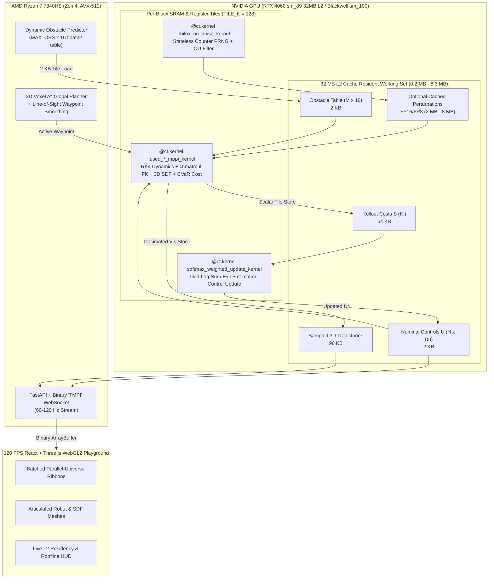

# TileMPPI System Architecture

**TileMPPI** is a 16,384-parallel-universe Model Predictive Path Integral (MPPI) real-time control engine built around the **NVIDIA `cuTile` (`cuda.tile`)** tile-based GPU programming model and engineered to lock its entire working set inside the **32 MB L2 Cache** of the NVIDIA GeForce RTX 4060 Laptop GPU (`sm_89`, Ada Lovelace) while providing seamless forward compatibility with NVIDIA Blackwell (`sm_100` / `sm_120`).

---

## 1. End-to-End Heterogeneous Control Pipeline

---

## 2. The 32 MB L2 Cache Residency Breakthrough

### Why Unfused PyTorch MPPI Bottlenecks on Laptop GPUs
On an NVIDIA GeForce RTX 4060 Laptop GPU, raw FP32 compute reaches ~15–22 TFLOPS (and 4th-Gen Tensor Cores reach ~60–120 TOPS in FP16/FP8), but the external GDDR6 memory interface is constrained to a **128-bit bus (~256 GB/s)**. However, the Ada Lovelace AD107 die features an unusually large **32 MB L2 cache** delivering **>1.5 TB/s** of on-chip bandwidth.

A standard unfused PyTorch MPPI implementation over $K = 16,384$ rollouts, horizon $H = 32$, padded state $D_x = 32$, control $D_u = 16$, and $M = 32$ obstacles materializes intermediate global tensors at every timestep:
- 4 RK4 stage state + derivative tensors: $8 \times K \times H \times D_x \times 4\text{ B} = 536.87\text{ MB}$
- State trajectory history tensor: $K \times (H + 1) \times D_x \times 4\text{ B} = 69.21\text{ MB}$
- Pairwise SDF distance & normal buffers: $4 \times K \times H \times M \times 4\text{ B} \approx 268.44\text{ MB}$
- Control noise & perturbed action tensors: $2 \times K \times H \times D_u \times 4\text{ B} = 67.11\text{ MB}$

Total unfused global memory traffic exceeds **670 MB per control step**—over **21× larger** than the 32 MB L2 cache, forcing continuous DRAM thrashing across the 128-bit bus.

### Fused `TileMPPI` L2-Resident Formulation
`TileMPPI` restructures the entire rollout + collision + cost pipeline into tile blocks of size `TILE_K = 128` universes:
1. Each tile block loads the initial state $\mathbf{x}_0$ (`128 B`), the nominal horizon control table $\mathbf{U} \in \mathbb{R}^{H \times D_u}$ (`2 KB`), and the packed dynamic obstacle table $\mathcal{O} \in \mathbb{R}^{M \times 16}$ (`2 KB`).
2. Inside the horizon loop $t = 0, \dots, H-1$, the intermediate state tile `(TILE_K, D_x)` and all four RK4 stage tiles `(k1, k2, k3, k4)` remain **100% in SM registers and shared SRAM (`< 24 KB` per block)**—never touching global VRAM.
3. Perturbations $\boldsymbol{\epsilon}_{k,t}$ are either synthesized inline via stateless counter-based Philox + Ornstein-Uhlenbeck recurrence (`0 MB` global traffic) or streamed from an L2-pinned `FP8 (e4m3fn)` / `FP16` perturbation buffer (`8.39 MB` in FP8, `16.78 MB` in FP16).
4. Only the terminal scalar cost tile $S \in \mathbb{R}^{\text{TILE\_K}}$ (`64 KB` across all 16,384 universes) and decimated visualization positions for $N_{\text{vis}} = 256$ paths (`96 KB`) are written back to L2.

Total global memory footprint drops to **0.20 MB (inline noise) – 8.58 MB (FP8 cached)**, staying **100% locked inside the 32 MB L2 cache**.

---

## 3. Mathematical Formulation

### 3.1 Ornstein-Uhlenbeck Colored Perturbations
To prevent high-frequency actuator chatter across horizon steps $t \in \{0, \dots, H-1\}$, each rollout $k \in \{0, \dots, K-1\}$ evolves temporally correlated perturbations:

$$\boldsymbol{\epsilon}_{k,0} = \boldsymbol{\sigma} \odot \mathbf{z}_{k,0}, \qquad \boldsymbol{\epsilon}_{k,t} = \rho_{\text{OU}} \boldsymbol{\epsilon}_{k,t-1} + \sqrt{1 - \rho_{\text{OU}}^2} \, (\boldsymbol{\sigma} \odot \mathbf{z}_{k,t})$$

where $\mathbf{z}_{k,t} \sim \mathcal{N}(\mathbf{0}, \mathbf{I}_{D_u})$ is generated deterministically in registers via 4-round counter-based Philox bijection followed by the Box-Muller transform on keyed `(seed, rollout_id, step_t, control_dim)`.

### 3.2 Fourth-Order Runge-Kutta (RK4) Tile Integration
Given clamped control $\mathbf{u}_{k,t} = \text{clip}(\mathbf{u}_t^{\text{nom}} + \boldsymbol{\epsilon}_{k,t}, \mathbf{u}_{\min}, \mathbf{u}_{\max})$, the state tile advances via:

$$\begin{aligned}
\mathbf{k}_1 &= f(\mathbf{x}_{k,t}, \mathbf{u}_{k,t}), & \mathbf{k}_2 &= f\!\left(\mathbf{x}_{k,t} + \tfrac{\Delta t}{2}\mathbf{k}_1, \mathbf{u}_{k,t}\right), \\
\mathbf{k}_3 &= f\!\left(\mathbf{x}_{k,t} + \tfrac{\Delta t}{2}\mathbf{k}_2, \mathbf{u}_{k,t}\right), & \mathbf{k}_4 &= f(\mathbf{x}_{k,t} + \Delta t\mathbf{k}_3, \mathbf{u}_{k,t}),
\end{aligned}$$

$$\mathbf{x}_{k,t+1} = \Pi_{\mathcal{M}}\!\left(\mathbf{x}_{k,t} + \frac{\Delta t}{6}(\mathbf{k}_1 + 2\mathbf{k}_2 + 2\mathbf{k}_3 + \mathbf{k}_4)\right)$$

where $\Pi_{\mathcal{M}}$ projects $SO(3)$ unit quaternions back onto the unit hypersphere $\mathbf{q} \leftarrow \mathbf{q} / \|\mathbf{q}\|_2$.

### 3.3 Differentiable 3D SDF Barrier & CVaR Risk-Aware Cost
At horizon time $\tau_t = t \Delta t$, each dynamic obstacle $m \in \{1, \dots, M\}$ moves along $\mathbf{p}_m(\tau_t) = \mathbf{p}_{m,0} + \mathbf{v}_m \tau_t + \frac{1}{2}\mathbf{a}_m \tau_t^2$. The minimum signed distance $d(\mathbf{p}_{k,t}, \tau_t) = \min_m \text{SDF}_m(\mathbf{p}_{k,t}, \tau_t)$ induces a two-tier collision barrier:

$$\phi_{\text{coll}}(d) = w_{\text{hard}} \max(0, r_{\text{robot}} + m_{\text{safe}} - d)^2 + w_{\text{soft}} \exp\!\big(-\alpha (d - r_{\text{robot}})\big)$$

With uncertainty-scaled collision inflation for tail robustness ($\text{CVaR}_\alpha$), the total rollout cost is:

$$S_k = \phi_{\text{term}}(\mathbf{x}_{k,H}, \mathbf{g}) + \sum_{t=0}^{H-1} \left( \ell_{\text{track}}(\mathbf{x}_{k,t}, \mathbf{g}_{\text{wp}}) + \phi_{\text{coll}}(d_{k,t}) + \frac{\gamma}{2} \mathbf{u}_{k,t}^\top \boldsymbol{\Sigma}^{-1} (\mathbf{u}_t^{\text{nom}} - \mathbf{u}_{k,t}) + w_{\Delta u} \|\mathbf{u}_{k,t} - \mathbf{u}_{k,t-1}\|_2^2 \right)$$

### 3.4 Numerically Stable Log-Sum-Exp & Adaptive ESS Temperature
Let $\beta = \min_k S_k$. The importance weights and Effective Sample Size (ESS) are:

$$w_k = \frac{\exp\!\left(-\frac{1}{\lambda}(S_k - \beta)\right)}{\sum_{j=0}^{K-1} \exp\!\left(-\frac{1}{\lambda}(S_j - \beta)\right)}, \qquad \text{ESS} = \frac{1}{\sum_{k=0}^{K-1} w_k^2}$$

The optimal control update is computed via tiled Tensor Core matrix multiplication (`ct.matmul`):

$$\mathbf{U}^{\text{new}} = \mathcal{S}_{\text{SG}}\!\left(\text{clip}\!\left(\mathbf{U}^{\text{nom}} + \sum_{k=0}^{K-1} w_k \boldsymbol{\epsilon}_k, \, \mathbf{u}_{\min}, \, \mathbf{u}_{\max}\right)\right)$$

where $\mathcal{S}_{\text{SG}}$ is a causal boundary-preserving Savitzky-Golay horizon filter.

---

## 4. Five-Backend Execution Architecture (`sm_89` ↔ `sm_100` ↔ CPU CI)

| Backend ID | Target Hardware | Execution Mechanism | Primary Purpose |
| :--- | :--- | :--- | :--- |
| `cutile` | NVIDIA Blackwell (`sm_100+`) + CUDA 13.1+ | Native `cuda.tile` compiler (`tileiras` cubin) | Canonical native hardware `cuTile` execution |
| `cutile_sim` | Any GPU / CPU (`Windows`, `Linux`, `CI`) | Executes unmodified `@ct.kernel` functions tile-by-tile + Static AST & SRAM Verifier | 100% mathematical & structural verification of `@ct.kernel` code |
| `triton` | NVIDIA Ada `sm_89` / Ampere / Hopper (Linux/WSL2) | OpenAI Triton JIT tile kernels with `.cg`/`.ca` L2 hints | Native `sm_89` tile kernel execution & `cuTile vs. Triton` comparison |
| `torch_gpu` | NVIDIA Ada `sm_89` RTX 4060 (Windows & Linux) | Fused CUDA Tensor-Core rollout (`fp32`, `fp16`, `fp8_e4m3fn`) | High-frequency 16,384-rollout real-time GPU execution on Windows & Linux |
| `numpy_cpu` | AMD Ryzen 7 7840HS / GitHub Actions CPU | Vectorized NumPy golden reference | Deterministic golden parity reference & zero-GPU CI |
