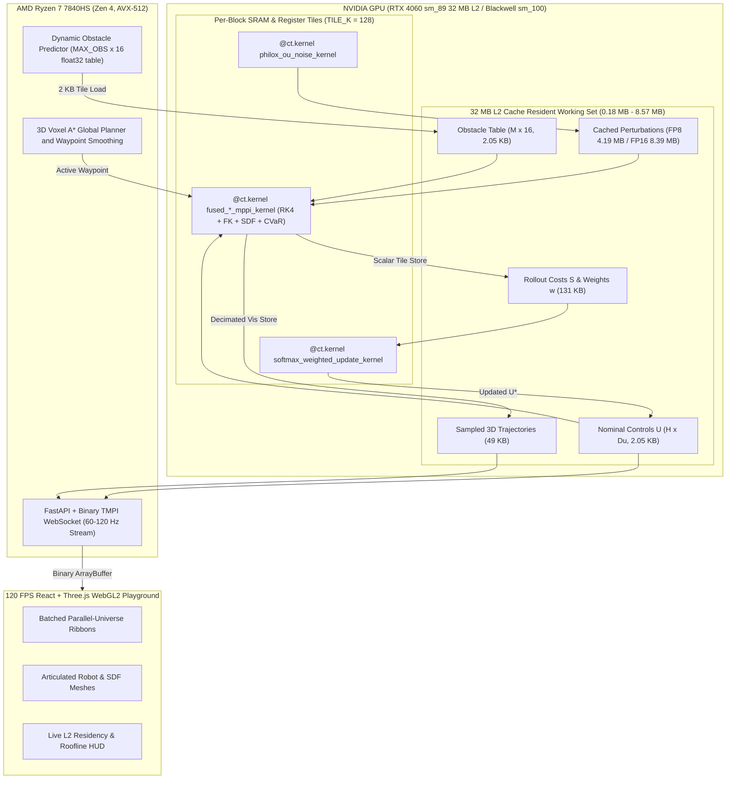

# TileMPPI System Architecture

**TileMPPI** is a 16,384-parallel-universe Model Predictive Path Integral (MPPI) real-time control engine built around the **NVIDIA `cuTile` (`cuda.tile`)** tile-based GPU programming model and engineered to lock its entire working set inside the **32 MB L2 Cache** of the NVIDIA GeForce RTX 4060 Laptop GPU (`sm_89`, Ada Lovelace) while providing seamless forward compatibility with NVIDIA Blackwell (`sm_100` / `sm_120`).

---

## 1. End-to-End Heterogeneous Control Pipeline

---

## 2. The 32 MB L2 Cache Residency Breakthrough

### Why Unfused PyTorch MPPI Bottlenecks on Laptop GPUs
On an NVIDIA GeForce RTX 4060 Laptop GPU, raw FP32 compute reaches ~15–22 TFLOPS (and 4th-Gen Tensor Cores reach ~60–120 TOPS in FP16/FP8), but the external GDDR6 memory interface is constrained to a **128-bit bus (~256 GB/s)**. However, the Ada Lovelace AD107 die features an unusually large **32 MB L2 cache** delivering **>1.5 TB/s** of on-chip bandwidth.

A standard unfused PyTorch MPPI implementation over $K = 16,384$ rollouts, horizon $H = 32$, padded state $D_x = 32$, control $D_u = 16$, and $M = 32$ obstacles materializes intermediate global tensors at every timestep:

- 4 RK4 stage state + derivative tensors: $8 \times K \times H \times D_x \times 4\text{ B} = 536.87\text{ MB}$
- State trajectory history tensor: $K \times (H + 1) \times D_x \times 4\text{ B} = 69.21\text{ MB}$
- Pairwise SDF distance & 3D normal buffers: $4 \times K \times H \times M \times 4\text{ B} = 268.44\text{ MB}$
- Control noise & perturbed action tensors: $2 \times K \times H \times D_u \times 4\text{ B} = 67.11\text{ MB}$
- Per-step running & terminal cost buffers: $(H + 1) \times K \times 4\text{ B} = 2.16\text{ MB}$

Total unfused global memory traffic reaches **943.78 MB (`900.06 MiB`) per control step**—nearly **29.5× larger** than the 32 MB L2 cache, forcing continuous DRAM thrashing across the 128-bit bus.

### Fused `TileMPPI` L2-Resident Formulation
`TileMPPI` restructures the entire rollout + collision + cost pipeline into tile blocks of size `TILE_K = 128` universes:

1. Each tile block loads the initial state $\mathbf{x}_0$ (`152 B` header), the nominal horizon control table $\mathbf{U} \in \mathbb{R}^{H \times D_u}$ (`2.05 KB`), and the packed dynamic obstacle table $\mathcal{O} \in \mathbb{R}^{M \times 16}$ (`2.05 KB`).
2. Inside the horizon loop $t = 0, \dots, H-1$, the intermediate state tile `(TILE_K, D_x)` and all four RK4 stage tiles `(k1, k2, k3, k4)` remain **100% in SM registers and shared SRAM (`< 48 KB` per block)**—never touching global VRAM.
3. Perturbations $\boldsymbol{\epsilon}_{k,t}$ are either synthesized inline via stateless counter-based Philox + Ornstein-Uhlenbeck recurrence (`0 B` global traffic) or streamed from an L2-pinned compact perturbation buffer (`4.19 MB` in FP8 `e4m3fn`, `8.39 MB` in FP16 or FP32-compressed half-tile storage).
4. Only the scalar rollout costs $S \in \mathbb{R}^{K}$ & importance weights $w \in \mathbb{R}^{K}$ (`131.07 KB`) and decimated 3D visualization paths for $N_{\text{vis}} = 128$ rollouts (`49.15 KB`) reside in L2.

Total global memory footprint drops to **0.18 MB (inline noise) – 8.57 MB (FP16 cached)**, staying **100% locked inside the 32 MB L2 cache** and cutting global memory traffic by **110×–5,120×** (and **104.8×** on the measured Quadrotor $K=16,384$ benchmark).

---

## 3. Mathematical Formulation

### 3.1 Ornstein-Uhlenbeck Colored Perturbations
To prevent high-frequency actuator chatter across horizon steps $t \in \{0, \dots, H-1\}$, each rollout $k \in \{0, \dots, K-1\}$ evolves temporally correlated perturbations with per-channel scale $\boldsymbol{\sigma} = 0.22 \, \sigma_{\text{noise}} (\mathbf{u}_{\max} - \mathbf{u}_{\min})$ and correlation $\rho_{\text{OU}} \in [0, 1)$:

$$
\boldsymbol{\epsilon}_{k,0} = \boldsymbol{\sigma} \odot \mathbf{z}_{k,0}, \qquad \boldsymbol{\epsilon}_{k,t} = \rho_{\text{OU}} \boldsymbol{\epsilon}_{k,t-1} + \sqrt{1 - \rho_{\text{OU}}^2} \left(\boldsymbol{\sigma} \odot \mathbf{z}_{k,t}\right)
$$

where $\mathbf{z}_{k,t} \sim \mathcal{N}(\mathbf{0}, \mathbf{I}_{D_u})$ is generated deterministically in registers via a 4-round counter-based Philox bijection followed by the Box-Muller transform on keyed `(seed, k, t, d)` indices.

### 3.2 Fourth-Order Runge-Kutta (RK4) Tile Integration
Given clamped control $\mathbf{u}_{k,t} = \mathrm{clip}(\mathbf{u}_t^{\mathrm{nom}} + \boldsymbol{\epsilon}_{k,t}, \mathbf{u}_{\min}, \mathbf{u}_{\max})$, the state tile advances over step size $\Delta t$ via:

$$
\begin{aligned}
\mathbf{k}_1 &= f(\mathbf{x}_{k,t}, \mathbf{u}_{k,t}), & \mathbf{k}_2 &= f\left(\mathbf{x}_{k,t} + \frac{\Delta t}{2}\mathbf{k}_1, \mathbf{u}_{k,t}\right), \\
\mathbf{k}_3 &= f\left(\mathbf{x}_{k,t} + \frac{\Delta t}{2}\mathbf{k}_2, \mathbf{u}_{k,t}\right), & \mathbf{k}_4 &= f(\mathbf{x}_{k,t} + \Delta t\,\mathbf{k}_3, \mathbf{u}_{k,t}),
\end{aligned}
$$

$$
\mathbf{x}_{k,t+1} = \Pi_{\mathcal{M}}\left(\mathbf{x}_{k,t} + \frac{\Delta t}{6}\left(\mathbf{k}_1 + 2\mathbf{k}_2 + 2\mathbf{k}_3 + \mathbf{k}_4\right)\right)
$$

where $\Pi_{\mathcal{M}}$ projects $SO(3)$ orientation quaternions onto the unit hypersphere $\mathbf{q} \leftarrow \mathrm{sign}(q_w)\,\mathbf{q} / \|\mathbf{q}\|_2$.

### 3.3 Differentiable 3D SDF Barrier & CVaR Tail-Risk Cost
At horizon time $\tau_t = (t + 1)\Delta t$, each dynamic obstacle $m \in \{1, \dots, M\}$ moves along $\mathbf{p}_m(\tau_t) = \mathbf{p}_{m,0} + \mathbf{v}_m \tau_t + \frac{1}{2}\mathbf{a}_m \tau_t^2$. The minimum signed distance $d_{k,t} = \min_m \mathrm{SDF}_m(\mathbf{p}_{k,t}, \tau_t)$ induces a two-tier collision barrier with time-growing CVaR uncertainty inflation $\sigma_{\mathrm{CVaR}}(\tau_t) = 0.06\,\alpha_{\mathrm{CVaR}}\,w_{\mathrm{CVaR}}\sqrt{\tau_t}$:

$$
\phi_{\mathrm{coll}}(d_{k,t}, \tau_t) = w_{\mathrm{hard}} \max\left(0,\; r_{\mathrm{robot}} + m_{\mathrm{safe}} + \sigma_{\mathrm{CVaR}}(\tau_t) - d_{k,t}\right)^2 + w_{\mathrm{soft}} \exp\left(-\alpha (d_{k,t} - r_{\mathrm{robot}})\right)
$$

Let $d_{\min, k} = \min_{t} d_{k,t}$ be the worst-case clearance along rollout $k$. Combining per-step tracking, control effort, rate smoothness, barrier cost, terminal cost, and trajectory-level CVaR tail-risk penalty gives:

$$
S_k = \phi_{\mathrm{term}}(\mathbf{x}_{k,H}, \mathbf{g}_{\mathrm{wp}}) + \phi_{\mathrm{CVaR}}(d_{\min, k}) + \sum_{t=0}^{H-1} \left( \ell_{\mathrm{track}}(\mathbf{x}_{k,t}, \mathbf{g}_{\mathrm{wp}}, \mathbf{g}) + \phi_{\mathrm{coll}}(d_{k,t}, \tau_t) + w_u \|\mathbf{u}_{k,t} - \mathbf{u}_{\mathrm{hover}}\|_2^2 + w_{\Delta u} \|\mathbf{u}_{k,t} - \mathbf{u}_{k,t-1}\|_2^2 \right)
$$

where the trajectory-level worst-case CVaR penalty is:

$$
\phi_{\mathrm{CVaR}}(d_{\min, k}) = \frac{1}{4} w_{\mathrm{CVaR}}(1 + \alpha_{\mathrm{CVaR}}) w_{\mathrm{hard}} \max\left(0,\; r_{\mathrm{robot}} + 1.35\,m_{\mathrm{safe}} - d_{\min, k}\right)^2
$$

### 3.4 Numerically Stable Log-Sum-Exp, ESS & Savitzky-Golay Update
Let $\beta = \min_k S_k$ and temperature $\lambda > 0$. The clipped importance weights and Effective Sample Size (ESS) are:

$$
w_k = \frac{\exp\left(-\min\left(\frac{S_k - \beta}{\lambda},\; 60\right)\right)}{\sum_{j=0}^{K-1} \exp\left(-\min\left(\frac{S_j - \beta}{\lambda},\; 60\right)\right)}, \qquad \mathrm{ESS} = \frac{1}{\sum_{k=0}^{K-1} w_k^2}
$$

The optimal control update is computed via tiled Tensor Core matrix multiplication (`ct.matmul`) followed by clamping and a causal Savitzky-Golay horizon filter $\mathcal{S}_{\mathrm{SG}}$:

$$
\mathbf{U}^{\mathrm{new}} = \mathrm{clip}\left(\mathcal{S}_{\mathrm{SG}}\left(\mathrm{clip}\left(\mathbf{U}^{\mathrm{nom}} + \sum_{k=0}^{K-1} w_k \boldsymbol{\epsilon}_k,\; \mathbf{u}_{\min},\; \mathbf{u}_{\max}\right)\right),\; \mathbf{u}_{\min},\; \mathbf{u}_{\max}\right)
$$

---

## 4. Five-Backend Execution Architecture (`sm_89` ↔ `sm_100` ↔ CPU CI)

| Backend ID | Target Hardware | Execution Mechanism | Primary Purpose |
| :--- | :--- | :--- | :--- |
| `cutile` | NVIDIA Blackwell (`sm_100+`) + CUDA 13.1+ | Native `cuda.tile` compiler (`tileiras` cubin) | Canonical native hardware `cuTile` execution |
| `cutile_sim` | Any GPU / CPU (`Windows`, `Linux`, `CI`) | Executes unmodified `@ct.kernel` functions tile-by-tile + Static AST & SRAM Verifier | 100% mathematical & structural verification of `@ct.kernel` code |
| `triton` | NVIDIA Ada `sm_89` / Ampere / Hopper (Linux/WSL2) | OpenAI Triton JIT tile kernels with `.cg`/`.ca` L2 hints | Native `sm_89` tile kernel execution & `cuTile vs. Triton` comparison |
| `torch_gpu` | NVIDIA Ada `sm_89` RTX 4060 (Windows & Linux) | CUDA Graph-captured Tensor-Core rollout (`fp32`, `fp16`, `fp8_e4m3fn`) | High-frequency 16,384-rollout real-time GPU execution on Windows & Linux |
| `numpy_cpu` | AMD Ryzen 7 7840HS / GitHub Actions CPU | Vectorized NumPy golden reference | Deterministic golden parity reference & zero-GPU CI |
